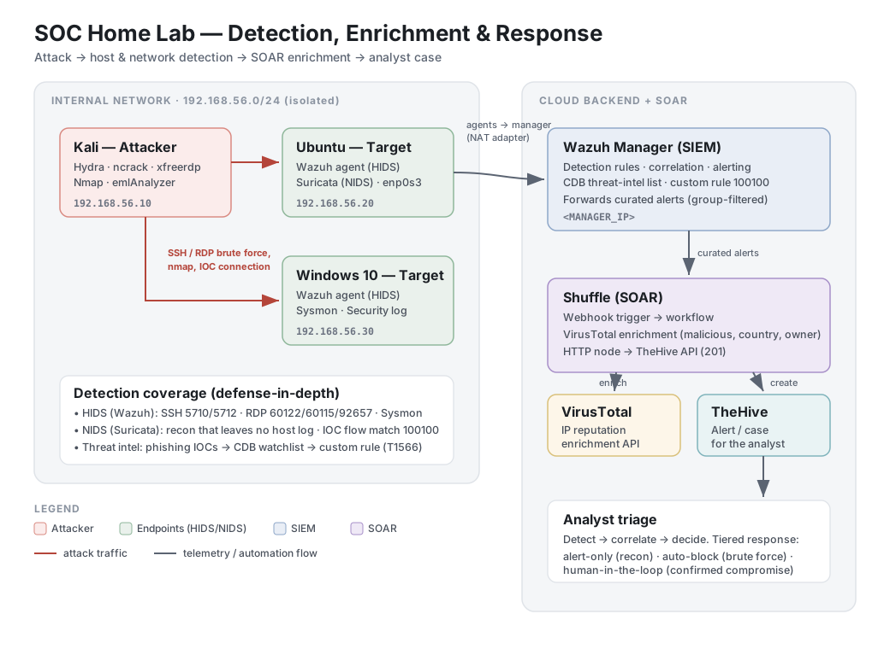

# SOC Home Lab — Detection, Enrichment & Automated Response

> At 02:33 UTC, a brute-force run from the lab's Kali host locked out the Windows
> target's `Client` account after a burst of failed RDP logons. The lockout stopped
> the loop cold — so the account was cleared and the attacker logged in with the
> now-known password, opening a real Type-10 RDP session. Wazuh fired **60115**
> (account lockout) and, on the successful login, **92657** (NLA pre-auth) and
> **92653** (the interactive session). I confirmed the source as `192.168.56.10`
> across every 4625 event, correlated the lockout with the subsequent 4624s, and
> traced the full sequence from first failure to interactive foothold — then on into
> a hands-on LSASS credential dump (Scenario 05), all in one ~98-second pass. That
> workflow — detect, correlate, decide — is what this lab is built to practice,
> automate, and document.

A self-built Security Operations Center lab demonstrating **end-to-end threat
detection across host and network layers, threat-intel-driven detection, and
SOAR automation** — from attack, to detection, to enrichment, to a case landing
in front of an analyst.

---

## What This Lab Demonstrates

- **End-to-end SOC workflow** — attack → detection → enrichment → case creation,
  not just tool deployment.
- **Defense in depth (HIDS + NIDS)** — host-based detection (Wazuh agents) *and*
  network-based detection (Suricata), covering attacks that one layer alone
  would miss.
- **Threat-intel-driven detection** — phishing email analyzed, IOCs extracted and
  operationalized into a Wazuh watchlist that fires on any connection to known
  infrastructure.
- **SOAR automation** — Wazuh → Shuffle → VirusTotal enrichment → TheHive case,
  fully automated.
- **Automated response** — a brute-force source is auto-blocked by a Wazuh
  `firewall-drop` active response (temporary iptables ban), validated end to end
  (Scenario 03).
- **Detection engineering judgment** — custom rules, alert tuning to cut noise,
  and reasoning about when a rule *should not* fire (false positives).
- **Real troubleshooting** — a documented log of the engineering problems solved
  to make the pipeline work (see [Challenges & Resolutions](docs/challenges-and-resolutions.md)).

---

## Skills at a Glance

| Domain | Tools / Techniques |
|---|---|
| SIEM / HIDS | Wazuh (agents, custom rules, CDB lists, correlation) |
| NIDS | Suricata (Emerging Threats ruleset, eve.json) |
| Endpoint telemetry | Sysmon (Windows), journald (Linux) |
| SOAR / automation | Shuffle (SOAR workflows, webhook integration, API) |
| Threat intelligence | VirusTotal enrichment, abuse.ch feeds, IOC watchlists |
| Case management | TheHive (alerts, cases, observables) |
| Adversary simulation | Hydra, ncrack, xfreerdp, Nmap, phishing analysis (emlAnalyzer) |
| Frameworks | MITRE ATT&CK mapping |

---

## Architecture



<details>
<summary>Text version of the diagram</summary>

```
                         INTERNAL NETWORK (192.168.56.0/24)
   ┌──────────────┐          attack traffic          ┌──────────────────┐
   │   Kali       │ ───────────────────────────────▶ │  Ubuntu target   │
   │  Attacker    │   SSH/RDP brute force, nmap,      │  Wazuh agent +   │
   │ 192.168.56.10│   IOC connection                 │  Suricata (NIDS) │
   └──────────────┘ ───────────────────────────────▶ │ 192.168.56.20    │
          │                                           └────────┬─────────┘
          │                                           ┌────────┴─────────┐
          └─────────────────────────────────────────▶│  Windows target  │
                                                      │  Wazuh agent +   │
                                                      │  Sysmon          │
                                                      └────────┬─────────┘
                                                               │ NAT adapter
                                                               ▼  (internet)
                                          ┌────────────────────────────────┐
                                          │       Wazuh Manager (cloud)     │
                                          │  rules · CDB threat list ·      │
                                          │  correlation · alerting         │
                                          └────────────────┬────────────────┘
                                                           │ forwards curated alerts
                                                           ▼
                                          ┌────────────────────────────────┐
                                          │        Shuffle (SOAR)           │
                                          │  webhook → VirusTotal enrich    │
                                          └────────────────┬────────────────┘
                                                           ▼
                                          ┌────────────────────────────────┐
                                          │           TheHive               │
                                          │   alert / case for analyst      │
                                          └────────────────────────────────┘
```

</details>

Each VM uses two adapters: an **internal** adapter (isolated attack traffic) and
a **NAT** adapter (lets agents reach the cloud backend). See
[docs/architecture.md](docs/architecture.md) for the full design and rationale.

---

## Detection Scenarios

| # | Scenario | Severity | MITRE | Detection rule | Log source | Time to alert¹ | Status |
|---|---|---|---|---|---|---|---|
| 01 | [Nmap Recon](docs/scenarios/01-nmap-recon.md) | Low | T1046 / T1595 | Suricata SID 2200025 + ET SCAN (e.g. 2018489) → Wazuh 86601 | Suricata NIDS | ~1.3 s | ✅ Validated (gaps documented) |
| 02 | [Phishing Investigation → SOAR](docs/scenarios/02-phishing-ioc.md) | High | T1566.002 (email) / T1204.001 (click) | Wazuh 100100 (CDB http match) | Suricata NIDS → Wazuh | ~1–2 s² | ✅ Validated |
| 03 | [SSH Brute Force](docs/scenarios/03-ssh-brute-force.md) | Medium | T1110 | Wazuh 5710 / 5712 | journald (Ubuntu agent) | ~1–2 s¹ | ✅ Validated |
| 04 | [RDP Brute Force → Lockout → Session](docs/scenarios/04-rdp-brute-force.md) | High | T1110.001 → T1021.001 / T1078.003 | Wazuh 60122 / 60115 / 92657 / 92653 | Windows Security (agent) | ~1.1–1.3 s | ✅ Validated |
| 05 | [Credential Dumping (Mimikatz / LSASS)](docs/scenarios/05-credential-dumping.md) | Critical | T1105 → T1003.001 / T1003 | Wazuh 92075 + 92900 + custom 100002 | Sysmon EID 1 / 10 (agent) | ~1.3 s | ✅ Validated |

¹ **Time to alert** = event time → Wazuh alert, measured from the captured evidence (see each scenario doc). The SSH figure is approximate: 5712 is a correlation rule and journald is second-resolution.
² Phishing (100100) matches a Suricata **http** transaction event (logged per request), so it fires in ~1–2 s. (Matching a `flow` record instead would add ~60 s of flow-timeout latency; `http` is used for near-real-time detection of the HTTP callback — a deliberate specificity-vs-coverage call, see Scenario 02 §10.)

> **SOAR → alert creation.** Phishing (02), SSH (03), RDP (04) and credential
> dumping (05) are forwarded to Shuffle and raised as alerts in TheHive — end to end,
> a host event reaches an analyst-ready alert in **~5–7 s**, and the phishing alert
> now lands in the same range because its detection matches a Suricata http event
> rather than waiting on a flow record (footnote 2). Nmap (01) is detection-only,
> deliberately held back from the SOAR layer as network-sensor noise.

See [docs/triage-methodology.md](docs/triage-methodology.md) for how each alert
is triaged — what I check next, malicious vs. benign reasoning, and when to
escalate.

---

## The SOAR Pipeline (Scenario 02 highlight)

The most complete automation path, end to end:

1. A reported phishing email is analyzed; its IOC (the phishing-server IP) is
   extracted and added to a Wazuh **CDB watchlist**.
2. A simulated click makes a victim host send an HTTP request to the phishing server;
   Suricata emits an http transaction event.
3. Wazuh **custom rule 100100** matches the http event's destination against the
   watchlist → level-12 alert, MITRE T1204.001 (the email itself maps to T1566.002).
4. The manager forwards the alert to a **Shuffle** workflow.
5. Shuffle looks the IOC up on **VirusTotal** and attaches it as an observable.
6. Shuffle creates an analyst-ready **alert in TheHive**, IOC attached.

> **Phishing isn't the only scenario that reaches TheHive.** Forwarding is filtered
> to the headline alerts — by rule group (`phishing`) and by rule ID (`5712`,
> `60115`, `92900`, `92657`) — so SSH (03), RDP (04) and the credential dump (05)
> are all raised as alerts too (RDP raises two: the lockout and the successful logon). The
> cred-dump is forwarded by its specific rule ID (`92900`), not the
> `sysmon_eid10_detections` group, which also carries benign Event-ID-10 rules
> (e.g. `92910`) that would be noise. The Nmap recon alerts (01) and per-attempt
> brute-force noise (`5710`, `60122`) are
> held back. Phishing is where **VirusTotal enrichment** is showcased: the lab IOC is
> a private IP (so VT returns nothing on the live run), and the enrichment capability
> is demonstrated with a clearly labeled synthetic test event (Scenario 02 §5b).

Full walkthrough: [docs/scenarios/02-phishing-ioc.md](docs/scenarios/02-phishing-ioc.md).

---

## Repository Structure

```
README.md                          ← you are here
docs/
  architecture.md                  ← full architecture + networking design
  scenarios/                       ← per-attack IR reports (detect→triage→respond)
    01-nmap-recon.md
    02-phishing-ioc.md
    03-ssh-brute-force.md
    04-rdp-brute-force.md
    05-credential-dumping.md
  triage-methodology.md            ← analyst triage logic
  challenges-and-resolutions.md    ← engineering problems solved
  mitre-coverage.md                ← ATT&CK mapping
config/                            ← reproducible configs (sanitized)
  local_rules.xml                  ← custom Wazuh rules
  phishing-iocs                    ← CDB threat-intel list
  ossec-integration.xml            ← Shuffle integration block
  shuffle-workflow.json            ← exported SOAR workflow (secrets scrubbed)
evidence/                          ← screenshots + raw alert JSON per scenario
```

---

## Honesty & Scope Notes

- The lab is isolated; the phishing IOC is a **lab-owned phishing server**
  (`192.168.56.99`) with its own IP, so the IOC is real and reachable within the
  lab. "Known-bad" means known-bad *within this lab's threat list* — exactly how
  real watchlists work. The IOC is a private IP, so VirusTotal returns nothing on
  the live run; the enrichment *capability* is demonstrated with a **clearly
  labeled synthetic test event** carrying a genuinely malicious IP (no traffic is
  ever sent to it) — documented in Scenario 02 §5b.
- All attack traffic targets the author's own lab VMs only.
- Cloud backend IPs and credentials are redacted in this public repo.
- **Timestamps:** lab hosts run different local timezones, so wall-clock values
  differ between attacker and analyst screenshots. Correlate all evidence by
  Wazuh **event ID** and the **UTC timestamp** in each alert — never by local
  clock.
