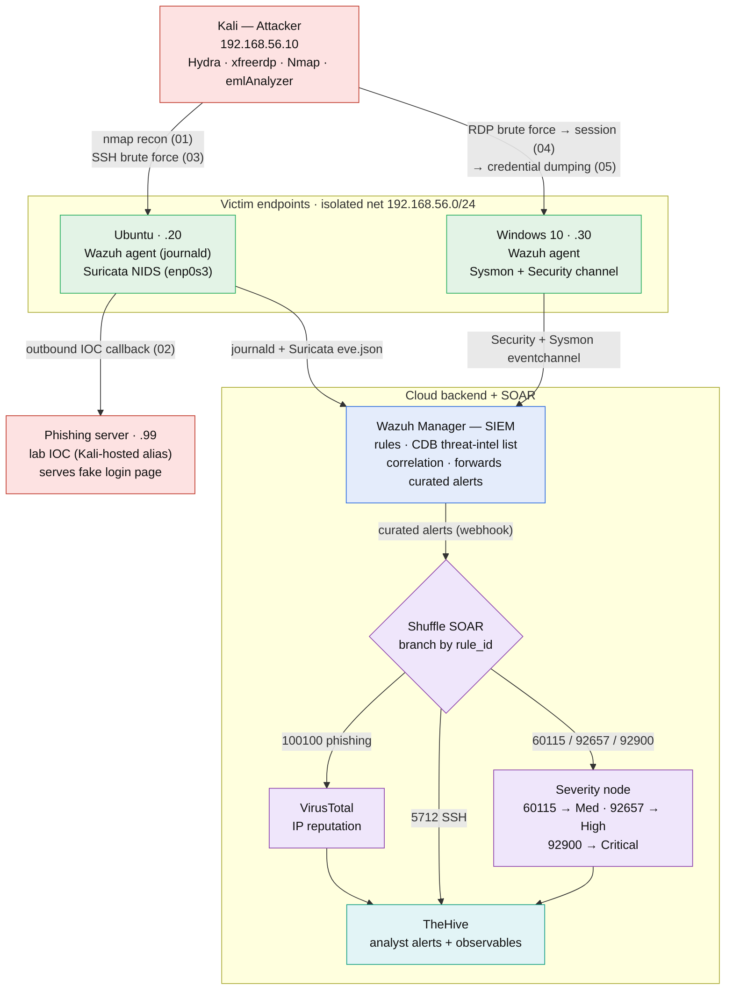

# Architecture & Design

A self-built SOC lab demonstrating end-to-end threat detection, enrichment, and
case management across host and network layers, with SOAR automation. Built on
VirtualBox VMs with a cloud-hosted backend.

> **Note on redaction:** public cloud IPs are shown as `<MANAGER_IP>` /
> `<THEHIVE_IP>` in this public repo. Internal RFC1918 lab addresses
> (`192.168.56.0/24`) are kept because they are non-routable and illustrate the
> design.

---

## 1. Components

| Component | Role | Location |
|---|---|---|
| Kali Linux | Attacker | VM, internal net `192.168.56.10` |
| Ubuntu | Victim endpoint + network sensor | VM, `192.168.56.20` (internal) + NAT |
| Windows 10 | Victim endpoint | VM, `192.168.56.30` (internal) + NAT |
| Wazuh Manager | SIEM / correlation / alerting | Cloud server `<MANAGER_IP>` |
| TheHive | Case management | Cloud server `<THEHIVE_IP>:9000` |
| Shuffle (SaaS) | SOAR / automation | shuffler.io |
| VirusTotal | Threat-intel enrichment | External API |

**Versions:** Wazuh 4.14.7 · Suricata 8.0.7 · FreeRDP 3.x (`xfreerdp3`) · Hydra 9.7
· Nmap 7.991 · Mimikatz 2.2.0 · TheHive 5.8.0 · Shuffle Cloud (Scale tier) · Sysmon
(Windows). Lab hosts use static IPs on an
isolated `192.168.56.0/24` internal network (setup in §2).

### End-to-end flow

Both agents report to the manager on their own path — Ubuntu ships journald +
Suricata `eve.json`, Windows ships the **Security** and **Sysmon** event channels —
which is why the Windows→manager arrow is drawn separately: the RDP (04) and
credential-dumping (05) detections ride the Windows path, the SSH (03) and Suricata
(01/02) detections the Ubuntu path.

---

## 2. Networking design

Each VM uses **two adapters** — a deliberate segmentation choice:

- **Adapter 1 — Internal Network (`intnet`)**: carries attack traffic between Kali
  and the victims, isolated from the internet so the "attack range" is contained.
  No DHCP on an internal network, so hosts use **static IPs** (`192.168.56.0/24`).
- **Adapter 2 — NAT**: gives victims internet access so their Wazuh agents can
  reach the cloud manager and packages/rules can update.

Static IPs were set via `nmcli` (NetworkManager) or `netplan`; the internal
adapter is given **no default gateway**, so internet-bound traffic routes out the
NAT adapter instead.

**Why it matters:** this models real network segmentation and produced a genuine
lesson about sensor placement — Suricata only sees the interface it monitors, so
traffic egressing the NAT adapter is invisible to it (see
[challenges-and-resolutions.md](challenges-and-resolutions.md), item 1).

---

## 3. Host-based detection (Wazuh HIDS)

Wazuh agents on Ubuntu and Windows collect host telemetry and ship it to the
cloud manager, which applies detection rules.

**Linux (Ubuntu)** — SSH brute force via Hydra triggers Wazuh rules **5710**
(invalid user) and **5712** (brute-force correlation). MITRE **T1110.001** (5710 tags
T1110.001; 5712's built-in tag is the parent **T1110**).

**Windows** — agent installed via MSI, pointed at the cloud manager; **Sysmon**
installed for process/DLL/file telemetry. RDP brute force produces Security
**Event ID 4625** (rule **60122**), a brute-force **correlation** (rule **60204**,
8 failures / 240 s), and account lockout **4740** (rule **60115**); then — after the
~10-minute lockout expired — a valid-credential logon recorded as a Type-3 NLA
**4624** (rule **92657**) and the interactive Type-10 session (rule **92653**). The
built-in 92657 flags possible pass-the-hash — a *false lead* here: the logon used
the actual **password**, not a replayed hash (the online guessing never got in; the
credential was obtained out-of-band, see
[Scenario 04 §2](scenarios/04-rdp-brute-force.md)). Sysmon
also surfaced account-discovery (T1087), remote-system discovery (T1018), and
scheduled-task DLL loads (T1053), plus a CIS benchmark (SCA) compliance scan.

**Key configuration lesson:** the Windows agent did not collect failed logons
until a `<localfile>` block for the **Security** event channel was added. Sysmon
≠ Security log — different sensors.

---

## 4. Network-based detection (Suricata NIDS)

Suricata runs on the Ubuntu target, watching `enp0s3`, with the full Emerging
Threats Open ruleset (**53,123** rules loaded, 0 failed — ET Open as of Oct 2026)
plus Suricata's built-in decoder rules, and
writes JSON to `/var/log/suricata/eve.json`, which the Wazuh agent forwards to the
manager (built-in Suricata decoders).

**`HOME_NET` is scoped to the victim hosts** (`[192.168.56.20,192.168.56.30]`),
which models Kali as an outside attacker. With Suricata's default `HOME_NET`
(all RFC 1918 ranges) Kali counted as "home", and most ET SCAN rules — written for
`$EXTERNAL_NET -> $HOME_NET` traffic — could never fire on it (see
[challenges-and-resolutions.md](challenges-and-resolutions.md), item 15). With the
fix, Suricata detects Nmap OS fingerprinting and scans that touch watched ports
(databases, VNC, SSH); a plain SYN scan of ports 1–1000 is **not** detected
(Scenario 01 §6).

**Why both HIDS and NIDS (defense-in-depth):** host-based detection only sees what
gets logged *on* a machine; a port scan generates no host log, so Wazuh alone is
blind to it, and only a network sensor can see it. Conversely, Suricata can't see a
successful login or a file change — those are host events. The two layers cover
different things; neither covers everything (see each scenario's blind spots).

---

## 5. Threat-intel-driven detection (phishing IOC)

A reported phishing email is analyzed (T1566.002), its IOCs extracted, and the
phishing-server IP loaded into a Wazuh **CDB list** referenced by **custom rule
100100** (level 12). When a victim host connects to the server (a simulated click),
Suricata emits an http transaction event that rule 100100 matches in near-real-time
— the observed outbound HTTP callback is T1204.001. Full walkthrough:
[scenarios/02-phishing-ioc.md](scenarios/02-phishing-ioc.md).

The lab IOC is a **lab-owned phishing server** (`192.168.56.99`) with its own IP, so
the IOC is real and reachable within the lab. "Known-bad" means known-bad *within
this lab's threat list*, exactly how real watchlists work. Because the IOC is a
private IP, VirusTotal returns a non-informative result (0 malicious / 56 harmless) on the live run; the enrichment *capability*
is demonstrated with a clearly labeled synthetic test event (Scenario 02 §5b).

---

## 6. SOAR automation (Wazuh → Shuffle → TheHive)

The manager forwards curated alerts to a Shuffle webhook — filtered to the
actionable alerts, never a broad level: by rule **group** (`phishing`) and by rule
**ID** (`5712` SSH correlation, `60115` RDP lockout, `92657` RDP logon, `92900`
LSASS access). The cred-dump is forwarded by its specific rule ID rather than the
`sysmon_eid10_detections` group, which also carries other Event-ID-10 process-access
events (benign OneDrive activity in this lab) that would be noise. Per-attempt rules (`5710`, `60122`) and the Suricata
flood are deliberately excluded.

Inside Shuffle the workflow is **not linear — a `Branch` node routes on
`$exec.rule_id`** into three conditional paths, so each alert type gets the handling
it needs:

- **Phishing (`100100`) → VirusTotal → enriched POST.** The IOC's destination IP is
  looked up (`get_an_ip_address_report`) and the malicious / harmless counts are
  embedded in the TheHive alert. VT is applied **only** on this path — the one IOC
  type that can carry an external IP. On the live run the lab IOC is a private
  address, so VT returns a non-informative result (0/56); the enrichment is demonstrated with a clearly
  labeled synthetic external IP (Scenario 02 §5b).
- **SSH correlation (`5712`) → direct POST** — no VT (the brute-force source is a
  private IP).
- **Everything else (`60115`, `92657`, `92900`) → a `Severity` node → POST.** A
  small `execute_python` step sets the TheHive severity by rule ID
  (`{60115: Medium, 92657: High, 92900: Critical}`), so the cred-dump lands
  **Critical** and the RDP logon **High** — impact-based, not the detecting rule's
  level.

All three paths are **raw HTTP nodes** POSTing a hand-built JSON body to TheHive's
`/api/v1/alert`, each with an explicit `Content-Type: application/json` and an
`Authorization: Bearer` header whose key is pulled from Shuffle's cache
(`$shuffle_cache.hive-key.value`), never hardcoded. The exported workflow (secrets
scrubbed) is at [`config/shuffle-workflow.json`](../config/shuffle-workflow.json).

**Why a raw HTTP node instead of the TheHive app node:** the native app node
proved unreliable (empty body, content-type mismatch). A plain HTTP node — with
explicit `Content-Type: application/json`, an auth header, and a hand-built body —
is reliable and fully visible for debugging.

**Design principle — selective enrichment:** VirusTotal enrichment is meaningful
for network/IP-based IOCs (the phishing callback's destination), less so for
brute force (whose lab source is a private IP VT can't resolve). The mature design
applies enrichment selectively by alert type.

---

## 7. Response strategy (tiered model)

| Detection | Response | Rationale |
|---|---|---|
| Port scan (recon) | Alert only | Noisy; source IP is spoofable |
| Brute force (in progress) | Auto-block (`firewall-drop`, 300 s temporary ban) — **implemented & validated, Scenario 03** | High confidence, time-sensitive, reversible, source not spoofable (needs full TCP handshake) |
| Successful logon post-brute-force | Human-in-the-loop (analyst approves) | High impact, ambiguous, disruptive |

**Spoofability is the key distinction:** a SYN/ICMP scan can carry a forged source
IP, so auto-blocking it risks blocking an innocent/critical address (or being
weaponized to make you block yourself). A brute-force login requires a completed
TCP handshake, so its source IP is genuine and safe to block.

**Blocks are temporary and scoped.** The brute-force auto-block uses a short
`<timeout>` (300 s) so it self-reverses and gets reviewed rather than hardening into
a permanent deny-list, and it is justified only because the source is non-spoofable
and unambiguous (a non-existent user). In a real environment a shared NAT/VPN egress
could carry legitimate users, so the timeout stays short and the policy is reviewed —
auto-remediation is applied where the source is trustworthy, not everywhere.
Validated end to end in [Scenario 03 §4a](scenarios/03-ssh-brute-force.md).
