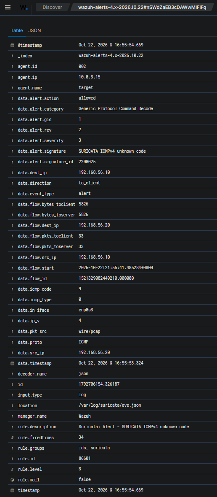

# Scenario 01 — [Low] Nmap Reconnaissance

| | |
|---|---|
| **MITRE ATT&CK** | T1046 (Network Service Discovery) / T1595 (Active Scanning) |
| **Attacker** | Kali — 192.168.56.10 (modeled as an external attacker; see §2) |
| **Target** | Ubuntu — 192.168.56.20 |
| **Detection source** | Suricata (NIDS) on `enp0s3` — Suricata built-in decoder rules + Emerging Threats Open, with `HOME_NET` scoped to the victim hosts |
| **Status** | ✅ Validated (re-tested 2026-10-27 — see §6 for what is and is not detected) |

---

## 1. Attack

Reconnaissance is the first stage of most intrusions — mapping which hosts are
up and which services are exposed. From Kali, Nmap was run against the Ubuntu
target:

```bash
sudo nmap -n -A 192.168.56.20     # aggressive: version + OS detection + scripts
```

The aggressive scan (`-A`) adds service-version probes, OS-fingerprinting packets
and script traffic on top of the port scan. `-n` disables reverse-DNS lookups
(added in the 2026-10-27 re-test after Nmap 7.991 aborted in its DNS resolver; it
does not change the traffic sent to the target).

> _Evidence: `evidence/scenario-01-nmap/attack-output.txt` (original run,
> 2026-10-22) and `evidence/scenario-01-nmap/retest-2026-10-27/` (re-test)_

---

## 2. Detection

A port scan generates almost **no host-side log** — the target OS does not record
"someone scanned me" — so Wazuh's host agent is effectively blind to it. That
makes this a **network-sensor** job. What Suricata actually catches was measured
by running three scan types and counting alerts per signature in `fast.log`:

| Scan | Before `HOME_NET` fix | After `HOME_NET` fix |
|---|---|---|
| `nmap -n -sS` (SYN port scan) | 0 alerts | 5 — ET SCAN *Suspicious inbound to* MSSQL / Oracle / MySQL / PostgreSQL port, *Potential VNC Scan 5800-5820* |
| `nmap -n -sV` (+ service versions) | 0 alerts | 4 — the four database-port rules |
| `nmap -n -A` (+ OS detection, scripts) | 34 — all `SURICATA ICMPv4 unknown code` | 45 across 8 signatures — adds **ET SCAN NMAP OS Detection Probe** (×5), the port rules, *Potential SSH Scan* |

**What fires and why:**

- **`SURICATA ICMPv4 unknown code` (SID 2200025)** — a Suricata built-in
  *decoder* rule, not an Emerging Threats rule. Nmap's OS detection sends an ICMP
  echo with an invalid code (9); the target echoes the code back (`CD=S` in the
  Nmap fingerprint), so the alert appears in both directions.
- **`ET SCAN NMAP OS Detection Probe` (SID 2018489)** — matches Nmap's 300-byte
  `"CCCC…"` UDP OS-detection probe to a high closed port (`CU=43498` in the
  re-test). ET metadata rates it `confidence Low, signature_severity Informational`.
- **ET SCAN port rules** — fire when the scan touches specific ports (databases,
  VNC, SSH). Nmap's default 1,000-port list includes those ports, so a default
  scan trips them; they are port-specific, not generic scan detection (see §6).

**The `HOME_NET` fix.** Suricata's default `HOME_NET`
(`[192.168.0.0/16,10.0.0.0/8,172.16.0.0/12]`) included the Kali attacker, and
`EXTERNAL_NET` is `!$HOME_NET`. Of the 274 enabled ET SCAN rules, 237 only match
traffic *from* `$EXTERNAL_NET` — including the OS Detection Probe rule
(`alert udp $EXTERNAL_NET 10000: -> $HOME_NET 10000:`) — so they could never fire
on Kali. Scoping `HOME_NET` to the victim hosts
(`[192.168.56.20,192.168.56.30]`) models Kali as an outside attacker and
activates them. See
[challenges-and-resolutions.md](../challenges-and-resolutions.md), item 15.

Alerts are written to `/var/log/suricata/eve.json`, forwarded by the Wazuh agent,
and surfaced on the manager under rule **86601** (Wazuh's rule for any Suricata
`event_type: alert`, level 3).

> _Evidence: `evidence/scenario-01-nmap/retest-2026-10-27/` — `before/` and
> `after/` (Nmap output, per-scan `fast.log` extract, per-signature counts),
> `homenet-change.diff`. Original 2026-10-22 capture:
> `suricata-fast-log.txt` (last 20 lines only), `wazuh-suricata-alert.json`,
> `wazuh-suricata.png`._



*Original capture (2026-10-22): rule **86601** for `SURICATA ICMPv4 unknown code`
on the monitored interface `enp0s3` — 34 alerts from the `-A` scan, the same count
the re-test reproduced before the `HOME_NET` fix.*

---

## 3. Triage

- **Source IP** — `192.168.56.10` probing a single target across many
  ports/services → classic reconnaissance.
- **Pattern** — OS-fingerprinting probes (malformed ICMP, Nmap's UDP probe) plus
  hits on database/VNC/SSH ports from one source in a short window is scanning
  behavior, not normal traffic.
- **Severity** — recon is pre-attack. On its own it is *informational-to-low*: it
  tells you someone is looking, not that they got in. This matches the rules' own
  rating (ET: `signature_severity Informational`; Wazuh 86601: level 3).

**Verdict:** Reconnaissance detected. Low immediate severity, but a meaningful
early-warning signal — especially valuable if the same source later escalates to
an exploit or brute force (the kind of correlation a SOC watches for).

---

## 4. Response

**Alert only — do not auto-block.** This is the deliberate counter-example to the
brute-force response:

- Scans are extremely common background noise; auto-blocking every scanner
  creates false positives and operational churn.
- A SYN/ICMP scan can carry a **spoofed source IP**. Auto-blocking on it can be
  weaponized — an attacker spoofs a scan "from" your own gateway or DNS to trick
  you into blocking critical infrastructure.

The correct response is to log, alert, and watch whether the same source
escalates. See [triage-methodology.md](../triage-methodology.md) and the tiered
response model in [architecture.md §7](../architecture.md#7-response-strategy-tiered-model).

---

## 5. Lessons Learned

- **HIDS and NIDS see different things.** Scanning is invisible to Wazuh's host
  agents; only the network sensor can see it — the clearest justification in the
  lab for running both (defense-in-depth).
- **A loaded rule is not a working rule.** 237 enabled ET SCAN rules could never
  fire because `HOME_NET` included the attacker. Test detections with real
  traffic — the original claim ("Suricata catches the scan") was only partly true
  until it was measured.
- **Sensor placement determines visibility.** Suricata only sees traffic on the
  interface it monitors (`enp0s3`). Traffic on another path (e.g. the NAT adapter)
  is invisible to it. See [challenges-and-resolutions.md](../challenges-and-resolutions.md), item 1.
- **Spoofability drives response policy.** The fact that scan source IPs can be
  forged is *the* reason recon is alert-only while brute force is block-eligible.

---

## 6. Blind spots (tested)

What this sensor configuration does **not** detect, so the coverage claim stays
honest:

- **Generic port scans that avoid the ports ET watches.** A SYN scan of ports
  1–1000 (`sudo nmap -n -sS -p 1-1000 192.168.56.20`) produced **no alerts** —
  none of the database/VNC ports are in that range. Detection of a plain port scan
  depends on *which* ports it touches.
- **Scans before the `HOME_NET` fix** — with the default `HOME_NET`, plain SYN and
  version scans produced no alerts at all (see §2 table).
- **Untested variants** — slow/timed scans (`-T0`/`-T1`, `--scan-delay`), non-SYN
  scan types (`-sA`, `-sF`, `-sN`, `-sX`, `-sU`) and traffic that does not cross
  `enp0s3` were not tested; assume they are not detected.

**Decision:** documented, not closed. Generic port-scan detection exists in
industry rule sets (e.g. a threshold rule on many SYNs / many destination ports
from one source); it was scoped out of this lab.
