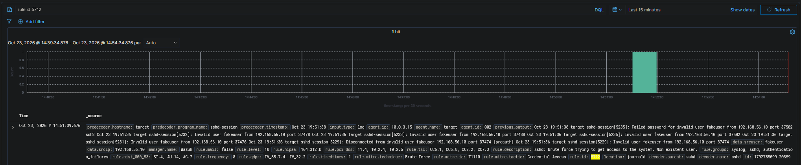
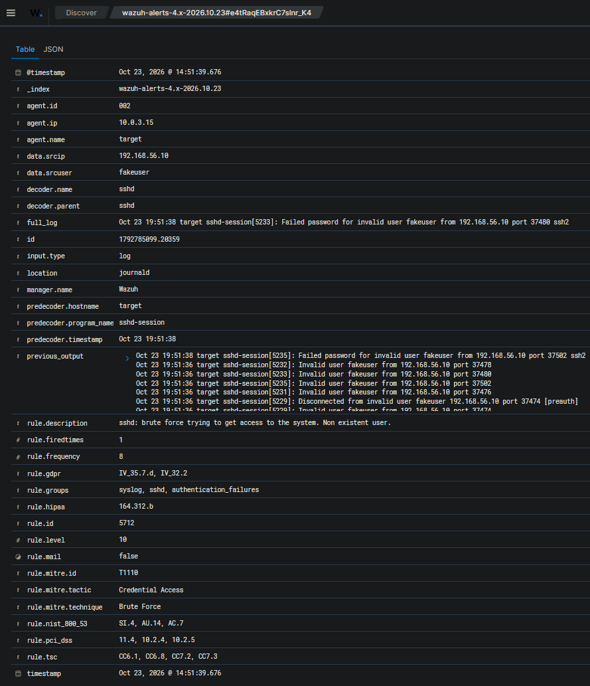
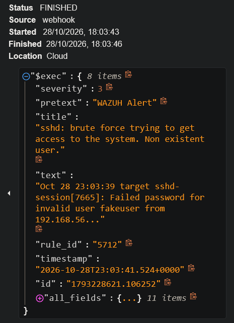
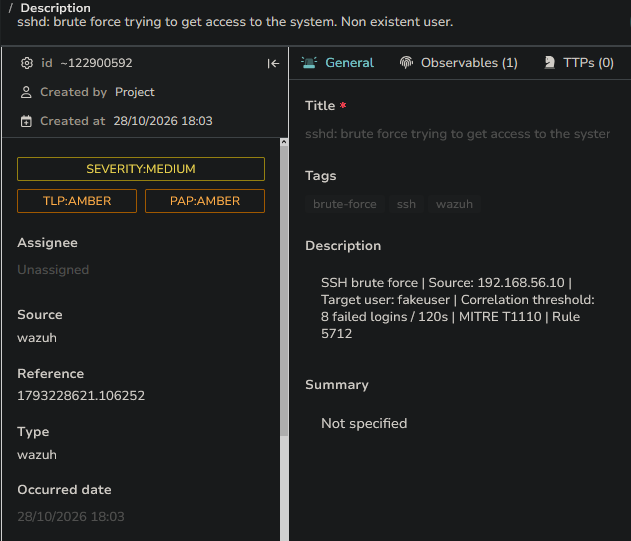

# Scenario 03 — [Medium] SSH Brute Force

| | |
|---|---|
| **MITRE ATT&CK** | T1110 (Brute Force) |
| **Attacker** | Kali — 192.168.56.10 |
| **Target** | Ubuntu — 192.168.56.20 |
| **Detection source** | Wazuh agent → journald (sshd) |
| **Rules fired** | 5710 (invalid user), 5712 (brute-force correlation) |
| **Reaches** | Detection → SOAR → TheHive case |
| **Status** | ✅ Validated |

---

## 1. Attack

SSH is the standard remote-access service on Linux and a constant target of
automated credential-guessing on the public internet. With OpenSSH running on
the Ubuntu target, a password list was run from Kali against a non-existent
username, so every attempt fails and no real account is ever at risk:

```bash
hydra -l fakeuser -P ~/passwords.txt ssh://192.168.56.20 -t 4
```

`-t 4` limits parallel connections so the burst looks like realistic tooling
rather than a flood. Hydra reports `0 valid password found` — the attack
completes without a successful login, which fixes the expected verdict up front:
*attempted access, no compromise*. The run captured here executed
`19:51:35–19:51:41 UTC`, and every artifact in this scenario comes from this one
run.

> _Evidence: `evidence/scenario-03-ssh/attack-output.txt`_

---

## 2. Detection

Each failed attempt is written by sshd to journald, collected by the Wazuh
agent, and matched on the manager. Two rules do the work:

- **Rule 5710** — "sshd: Attempt to login using a non-existent user." Fires once
  per attempt (level 5). On its own, a single 5710 is noise — a fat-fingered
  username looks identical.
- **Rule 5712** — "sshd: brute force trying to get access to the system. Non
  existent user." (level 10). This is the correlation rule: it fires once
  **eight** failures from one source stack up inside the time window. That shift
  from per-attempt noise to a single pattern alert is the whole point of
  brute-force detection.

The single hydra run produced exactly one 5712 correlation event —
`1792785099.20359` — and the raw alert, the SOAR run, and the case below all
carry that same ID.


*One 5712 hit for the run (`event 1792785099.20359`, `14:51:39` in the analyst's
browser timezone). The burst of failed logins is collapsed into this single
alert, so the per-attempt 5710 events never reach the analyst as individual
noise.*

Expanding that alert shows the fields triage actually uses — `data.srcip`,
`data.srcuser`, `rule.frequency`, and the MITRE mapping:


*Event `1792785099.20359` expanded: `frequency: 8`, `data.srcip: 192.168.56.10`,
`data.srcuser: fakeuser`, mapped to T1110 (Credential Access → Brute Force).*

> _Evidence: `evidence/scenario-03-ssh/alert-5712.json` (event `…20359`, level 10
> correlation), `evidence/scenario-03-ssh/alert-5710.json` (per-attempt sample
> from the same burst)._
>
> _All artifacts here share event ID `1792785099.20359` and UTC timestamp
> `19:51:39.676Z`, and the hydra run window (`19:51:35–41 UTC`) contains this
> 5712 event — confirming the attacker log and the detection are the same run.
> On reading timestamps across hosts, see the correlation note in the
> [README](../../README.md#honesty--scope-notes)._

---

## 3. Triage

- **Source IP** — a single source (`192.168.56.10`) across every attempt →
  targeted, not distributed noise. The IP is trustworthy because SSH requires a
  completed TCP handshake, which can't be spoofed.
- **Username** — `fakeuser`, which does not exist. A high volume of failures
  against a non-existent account is characteristic of automated scanning, not a
  legitimate user mistyping.
- **Rate** — eight failures inside the correlation window, far above human speed
  → tooling.
- **Correlation** — rule 5712 confirms the volume/time threshold was crossed.

**Verdict:** Confirmed brute-force attempt. No successful login
(`0 valid password found`), so the outcome is *attempted access, no
compromise* — but the source is a clear candidate for blocking.

---

## 4. Response — SOAR aggregation and case creation

The 5712 alert is forwarded to Shuffle by webhook. The key behavior here is
**aggregation**: Wazuh's correlation has already collapsed the burst, so Shuffle
receives **one** event for the whole run rather than one per failed login.


*The Shuffle run for event `1792785099.20359`: the `$exec` payload carries
`rule_id: 5712`, the sshd title, and `id: 1792785099.20359` — one actionable
event, not eight.*

Shuffle then opens a case in TheHive. This is the same path phishing (Scenario
02) takes — **SSH brute force reaches case creation too**; phishing is simply the
scenario where VirusTotal enrichment is showcased.


*TheHive case: `SEVERITY:MEDIUM`, tagged brute-force / ssh / wazuh, description
`SSH brute force | Source: 192.168.56.10 | Target user: fakeuser | Correlated
failed attempts: 8 | MITRE T1110 | Rule 5712`. The `Reference` is
`1792785099.20359` — the same event as the alert and Shuffle run above.*

A brute force in progress is a strong auto-block candidate: high confidence,
time-sensitive (every minute is more guesses), reversible, and backed by a
non-spoofable source IP. In the tiered response model this is the case that
justifies an automated `firewall-drop` rather than waiting for an analyst.

---

## 5. Lessons Learned

- Attacking a **non-existent user** keeps the exercise safe while still producing
  the exact detection signature.
- The split between the per-attempt rule (5710) and the correlation rule (5712)
  is the core of brute-force detection — a single failure is noise; the
  *pattern* is the alert, and only the pattern should reach the analyst.
- Correlation also does the SOAR a favor: because 5712 collapses the burst, the
  case queue sees one case per campaign, not one per guess.
- Timestamps are only trustworthy end-to-end when matched by **event ID** and
  UTC — hosts in a lab rarely share a timezone, so wall-clock alone will mislead.
- Contrast with Scenario 04 (Windows RDP): the same technique (T1110) surfaces
  through a completely different log source (journald vs. the Windows Security
  channel), which is why host coverage must span both platforms.
