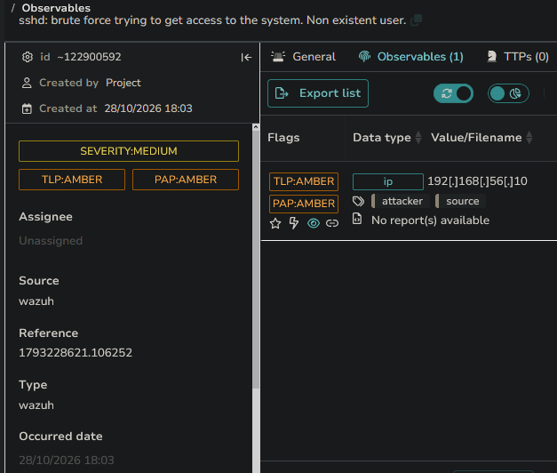

# Scenario 03 — [Medium] SSH Brute Force

| | |
|---|---|
| **MITRE ATT&CK** | T1110.001 (Brute Force: Password Guessing) — 5710 tags T1110.001; 5712's built-in tag is the parent T1110 |
| **Attacker** | Kali — 192.168.56.10 |
| **Target** | Ubuntu — 192.168.56.20 |
| **Detection source** | Wazuh agent → journald (sshd) |
| **Rules fired** | 5710 (invalid user), 5712 (brute-force correlation) |
| **Response** | Automated `firewall-drop` (temporary iptables ban) + SOAR → TheHive alert |
| **Reaches** | Detection → auto-block → SOAR → TheHive alert |
| **Status** | ✅ Validated (incl. live auto-block) |

---

## 1. Attack

SSH is the standard remote-access service on Linux and a constant target of
automated credential-guessing on the public internet. With OpenSSH running on
the Ubuntu target, a password list was run from Kali against a non-existent
username, so every attempt fails and no real account is ever at risk:

```bash
hydra -l fakeuser -P ~/passwords.txt ssh://192.168.56.20 -t 4 -w 5
```

`-t 4` limits parallel connections so the burst looks like realistic tooling
rather than a flood. Hydra attempts **25 password guesses** and reports
`0 valid password found` — no successful login, which fixes the expected verdict up
front: *attempted access, no compromise*. Every artifact in this scenario comes from
this one run — Wazuh correlation event **`1793228621.106252`** (detected
`23:03:41 UTC`). The attacker's host clock is offset from the backend, so all
evidence is tied by event ID + UTC, never wall-clock.

> _Evidence: `evidence/scenario-03-ssh/attack-output.txt`_

---

## 2. Detection

Each failed attempt is written by sshd to journald, collected by the Wazuh
agent, and matched on the manager. Two rules do the work:

- **Rule 5710** — "sshd: Attempt to login using a non-existent user." Fires once
  per attempt (level 5). On its own, a single 5710 is noise — a fat-fingered
  username looks identical.
- **Rule 5712** — "sshd: brute force trying to get access to the system. Non
  existent user." (level 10). This is the correlation rule
  (`frequency="8" timeframe="120"`): it fires when rule 5710 trips **8 times** from
  one source IP within 120 s. The `8` is the rule's configured *threshold*, not a
  count of distinct guesses — one invalid-user attempt logs more than one failure
  line, so the threshold is crossed by fewer passwords than the number implies. That
  shift from per-attempt noise to a single pattern alert is the whole point of
  brute-force detection.

The single hydra run produced exactly one 5712 correlation event —
`1793228621.106252` — and that detection, its SOAR run, and the TheHive alert below
all carry that ID. The per-attempt **5710** and the auto-block (**651**/**652**) are
separate alerts with their own event IDs, tied to this run by source IP and the UTC
window.


*One 5712 hit for the run (`event 1793228621.106252`). The burst of failed logins is
collapsed into this single alert, so the per-attempt 5710 events never reach the
analyst as individual noise.*

Expanding that alert shows the fields triage actually uses — `data.srcip`,
`data.srcuser`, `rule.frequency`, and the MITRE mapping:


*Event `1793228621.106252` expanded: `frequency: 8` (the threshold),
`data.srcip: 192.168.56.10`, `data.srcuser: fakeuser`, mapped to T1110 (Credential
Access → Brute Force).*

> _Evidence: `alert-5712.json` (event `…106252`, level 10 correlation),
> `alert-5710.json` (per-attempt sample — `firedtimes: 13` is the rule's running
> counter, not a guaranteed per-run total; the per-run failures are better read from
> `active-response-block.txt`'s `previous_output`)._
>
> _The 5712 detection, its SOAR run, and its TheHive alert all carry event ID
> `1793228621.106252` (UTC `23:03:41.524Z`); the per-attempt 5710 and the auto-block
> 651/652 are separate alerts with their own IDs. The attacker's host clock is offset
> from the backend, so evidence is correlated by event ID + UTC, never wall-clock —
> see the note in the [README](../../README.md#honesty--scope-notes)._

---

## 3. Triage

- **Source IP** — a single source (`192.168.56.10`) across every attempt →
  targeted, not distributed noise. The IP is trustworthy because SSH requires a
  completed TCP handshake, which can't be spoofed.
- **Username** — `fakeuser`, which does not exist. A high volume of failures
  against a non-existent account is characteristic of automated scanning, not a
  legitimate user mistyping.
- **Rate** — a rapid burst of failed logins that crossed rule 5712's correlation
  threshold (8 events / 120 s) far faster than a human could mistype → automated
  tooling.
- **Correlation** — rule 5712 confirms the volume/time threshold was crossed.

**Verdict:** Confirmed brute-force attempt. No successful login
(`0 valid password found`), so the outcome is *attempted access, no
compromise* — but the source is a clear candidate for blocking.

---

## 4. Response

### 4a. Automated containment — `firewall-drop` (validated)

A brute force in progress is a strong auto-block candidate: high confidence,
time-sensitive (every minute is more guesses), **reversible**, and backed by a
non-spoofable source IP (SSH needs a completed TCP handshake). So the 5712 alert
triggers a Wazuh **`firewall-drop` active response** (manager block:
[`config/active-response.xml`](../../config/active-response.xml)) that drops the attacker on the
target's iptables — with a **`<timeout>300</timeout>` temporary ban**, the
best-practice shape (time-boxed and self-reversing, not a permanent deny-list).

It fired and it worked: rule **651** "Host Blocked by firewall-drop Active Response"
recorded the `add` for `192.168.56.10` (acting on event `1793228621.106252`), and
`iptables -L` showed the live `DROP`. The block **dropped the attacker's source**
`192.168.56.10` mid-run (hydra still ran its queue to `1 of 1 completed`, its remaining
attempts failing against the dropped route) —
hydra queued 25 guesses, and rule 5710 logged multiple auth-failure events
(`firedtimes: 13` is the rule's running counter, not a guaranteed per-run total —
and one invalid-user attempt logs several lines, so distinct password attempts are
fewer) before the source was dropped. ~300 s later (the configured `<timeout>`), rule **652** "Host Unblocked"
recorded the `delete` — the ban auto-expired as configured.

> **Caveat — why this is scoped, not universal.** Auto-blocking is safe *here*
> because the source is a single, non-spoofable IP guessing a non-existent user. In
> production the same rule needs guardrails: a shared NAT/VPN egress could carry
> legitimate users, so the timeout stays short and blocks get reviewed. The scan
> case (Scenario 01) is deliberately *not* auto-blocked because its source is
> spoofable.

> _Evidence: `alert-651-block.json` (block), `alert-652-unblock.json` (auto-removed
> after 300 s), `active-response-block.txt` (the `active-responses.log` add/delete +
> the `iptables` DROP)._

### 4b. SOAR aggregation and alert creation

The same 5712 alert is also forwarded to Shuffle by webhook. The key behavior here
is **aggregation**: Wazuh's correlation has already collapsed the burst, so Shuffle
receives **one** event for the whole run rather than one per failed login.


*The Shuffle run for event `1793228621.106252`: the `$exec` payload carries
`rule_id: 5712`, the sshd title, and `id: 1793228621.106252` — one actionable
event, not many.*

Shuffle then opens an alert in TheHive. This is the same path phishing (Scenario
02) takes — **SSH brute force reaches alert creation too**; phishing is simply the
scenario where VirusTotal enrichment is showcased.


*TheHive alert: `SEVERITY:MEDIUM`, tagged brute-force / ssh / wazuh, description
`SSH brute force | Source: 192.168.56.10 | Target user: fakeuser | Correlation
threshold: 8 failed logins / 120s | MITRE T1110 | Rule 5712`. (The "8 failed logins"
is rule 5712's `frequency` threshold — 8 matching 5710 events, not 8 password
attempts.) The `Reference` is
`1793228621.106252` — the same event as the 5712 detection and the Shuffle run (the
auto-block 651/652 are separate alerts with their own IDs). The attacker IP is
attached as an observable (tagged attacker / source).*



---

## 5. Lessons Learned

- Attacking a **non-existent user** keeps the exercise safe while still producing
  the exact detection signature.
- The split between the per-attempt rule (5710) and the correlation rule (5712)
  is the core of brute-force detection — a single failure is noise; the
  *pattern* is the alert, and only the pattern should reach the analyst.
- Correlation also does the SOAR a favor: because 5712 collapses the burst, the
  alert queue sees one alert per campaign, not one per guess.
- **`frequency` is a threshold, not a tally.** 5712's `frequency="8"` is how many
  5710 events trip it, not how many passwords the attacker tried (25 here) — and
  because one invalid-user attempt logs multiple failure lines, the threshold is
  crossed by fewer distinct guesses than the number suggests. Report the rule's
  intent, not a raw count dressed up as "attempts."
- **Automated containment pays off when the source is trustworthy and the block is
  reversible.** The `firewall-drop` response blocked the brute-force source mid-run and
  auto-expired after 300 s — but that is only safe because the source is
  non-spoofable and the ban is temporary; a spoofable scan source (Scenario 01) is
  deliberately left alert-only.
- Timestamps are only trustworthy end-to-end when matched by **event ID** and
  UTC — hosts in a lab rarely share a timezone, so wall-clock alone will mislead.
- Contrast with Scenario 04 (Windows RDP): the same technique (T1110) surfaces
  through a completely different log source (journald vs. the Windows Security
  channel), which is why host coverage must span both platforms.
