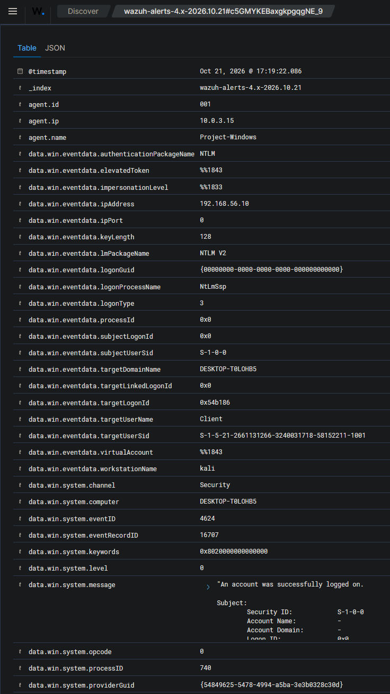

# Scenario 04 — [High] RDP Brute Force → Lockout → Compromise

Runs the full arc from first failed logon to confirmed compromise of a local
**administrator** account, written as an analyst would hand it off — in ticket
form. The successful-logon alert (rule 92657) is the escalation trigger: the
moment an attempt becomes a compromise.

| | |
|---|---|
| **MITRE ATT&CK** | T1110.001 (Brute Force: Password Guessing) → T1021.001 (Remote Services: RDP) / T1078.002 (Valid Accounts) — the successful-logon stage also flags T1550.002 (Pass the Hash) |
| **Attacker** | Kali — 192.168.56.10 (workstation `kali`) |
| **Target** | Windows 10 — DESKTOP-T0LOHB5 (192.168.56.30) |
| **Target account** | `Client` — a **local administrator** account |
| **Detection source** | Wazuh agent → Windows Security event channel |
| **Rules fired** | 60122 (logon failure, 4625) · 60115 (account lockout, 4740) · 92657 (successful remote logon, 4624) |
| **Reaches** | Detection → SOAR → **two** TheHive cases (lockout + compromise) |
| **Status** | ✅ Validated |

---

## 1. Attack

Remote Desktop (RDP) is the most commonly brute-forced Windows service on the
public internet. The attack targets `Client`, an existing **local administrator**
account on the host — a higher-value target than a purpose-made test account,
since compromising an admin grants broad control.

Hydra's RDP module proved unreliable (experimental, NLA handshake issues) and
`ncrack` gave no clear output; an `xfreerdp3` loop was the dependable method for
generating real authentication attempts:

```bash
for pass in $(cat ~/winpass.txt); do
  echo "=== Trying: $pass ==="
  xfreerdp3 /u:Client /p:"$pass" /v:192.168.56.30 /cert:ignore +auth-only
done
```

Each wrong password returned `ERRCONNECT_LOGON_FAILURE [0x00020014]`. Once the
failures crossed the account's lockout threshold, further attempts — **including
the one with the correct password** — returned
`ERRCONNECT_ACCOUNT_LOCKED_OUT [0x00020018]`. So the loop itself never produced a
successful logon: the account locked first, which is exactly the realistic
consequence of a sustained brute force against a lockout-protected system. Because
lockout interrupts the attack, the actual compromise was performed as a
**separate logon after the account was unlocked** — the pattern a real intrusion
follows when lockout defenses are in place.

> _Evidence: `evidence/scenario-04-rdp/attack-output.txt` (winning password
> redacted). This capture is the lockout-triggering run (`22:17:4x UTC`); the
> successful compromise below is the separate post-unlock logon at `22:19 UTC`._

---

## 2. Detection

The attempts generated Windows Security events on the `Client` account, collected
by the Wazuh agent and matched on the manager. The whole arc — failures, lockout,
and the successful logon — appears in one filtered view:


*One intrusion, end to end: failed logons (`4625`), the account lockout (`4740`),
and the successful logon (`4624`) — a single source (`192.168.56.10`, workstation
`kali`) against a single account (`Client`).*

Three rules carry the story:

- **Rule 60122** (level 5) — "Logon Failure - Unknown user or bad password," from
  **Event ID 4625** (Logon Type 3, NTLM), source `192.168.56.10`. One per failed
  attempt. _(event `1792621064.898521`)_
- **Rule 60115** (level 9) — "User account locked out (multiple login errors),"
  from **Event ID 4740**; the lockout names the caller: `Caller Computer Name:
  kali`. _(event `1792621064.895940`)_
- **Rule 92657** (level 6) — "Successful Remote Logon Detected … possible
  pass-the-hash attack," from **Event ID 4624** when the correct password finally
  worked after unlock. _(event `1792621162.933151`)_


*The compromise event `1792621162.933151`: `targetUserName: Client`, `Source
Network Address: 192.168.56.10`, `Workstation Name: kali`, `Logon Type: 3`,
`Authentication Package: NTLM` (NTLM V2) — a successful remote NTLM logon from the
attacking host, which is why Wazuh flags *possible pass-the-hash*.*

> _Evidence: `alert-60122.json`, `alert-60115.json`, `alert-92657.json`, and
> `wazuh-92657-detail-2.png` (full event fields)._
>
> _Timeline (authoritative UTC from the JSON): failed logons from ~`22:15`,
> lockout `22:17:43Z` (event record 16699), compromise `22:19:20Z` (record 16707)
> — correct causal order. A separate earlier logon as a different account
> (`testuser`, `22:11`) is unrelated to this intrusion and is out of scope. Match
> artifacts by event ID; on reading cross-host clocks see the
> [README](../../README.md#honesty--scope-notes) convention._

**Configuration note:** these detections did not work until a `<localfile>` block
for the **Security** event channel was added to the Windows agent's `ossec.conf`.
By default the agent collected Sysmon but not the Security log — two different
sensors. See [challenges-and-resolutions.md](../challenges-and-resolutions.md), item 5.

---

## 3. SOAR → case creation

The manager's Shuffle integration forwards the two **headline** RDP alerts — the
lockout (`60115`) and the compromise (`92657`) — by **rule ID**. The per-attempt
`60122` is deliberately *not* forwarded, so failed-logon noise never reaches the
SOAR layer. Each forwarded alert produces its own Shuffle run and its own TheHive
case, so both the mid-attack lockout and the confirmed compromise land in front of
an analyst:


*Shuffle run for the compromise: `rule_id 92657`, `id 1792621162.933151`.*


*TheHive compromise case: `SEVERITY:MEDIUM`, tagged host-based / wazuh, description
`Rule 92657 | Agent: Project-Windows | Successful Remote Logon Detected - User:
\Client …`. `Reference 1792621162.933151` ties the case to the exact Wazuh event.*

The lockout raises a **parallel case** a couple of minutes earlier
(`thehive-lockout.png`, `Reference 1792621064.895940`, rule 60115) — a valuable
mid-attack signal in its own right, not just a precursor to the compromise.

> _Evidence: `shuffle-rdp-compromise.png`, `shuffle-rdp-lockout.png`,
> `thehive-compromise.png`, `thehive-lockout.png`. No VirusTotal enrichment
> applies here — the source is a private RFC 1918 IP VT can't resolve; the relevant
> enrichment is host/identity context (see the Ticket below)._

---

## 4. Ticket

> The format a Tier 1 analyst hands off: summary → observations → enrichment →
> verdict → recommended action → escalation.

**Alert summary**
Successful RDP logon (rule 92657, possible pass-the-hash) to the local
administrator account `Client` on DESKTOP-T0LOHB5, preceded by a burst of failed
logons and an account lockout — all from a single source. Timeline: failed logons
from ~22:15 UTC, account lockout 22:17 UTC, successful logon 22:19 UTC.

**Observations**
- **Source** — `192.168.56.10` (workstation name `kali`), consistent across every
  4625, the 4740 lockout, and the final 4624. A single source driving all three
  stages is the signature of a targeted brute force, not scattered user error.
- **Target** — `Client`, a **local administrator** account. High impact if
  compromised.
- **Volume & timing** — a tight burst of failures in seconds (far faster than
  human typing) → automated tooling.
- **Lockout** — rule 60115 confirms the failures crossed the lockout threshold,
  i.e. the activity was sustained, not incidental.
- **The pivot** — rule 92657 shows a *successful* 4624 from the same attacking IP.
  Logon Type 3 + NTLM from an unexpected host is exactly the pattern that warrants
  escalation. Wazuh flags it as *possible pass-the-hash*.

**Enrichment**
VirusTotal is not meaningful here — the source is an internal/private IP (RFC
1918) that VT cannot resolve. The relevant enrichment is host/identity context:
`Client` is a local admin, the source is the known attacker host, and the logon
used NTLM (not Kerberos), consistent with pass-the-hash or direct credential use
over RDP. (Contrast Scenario 02, where the IOC is a real external IP and VT
enrichment applies.)

**Verdict** — **True Positive — confirmed compromise.** Not a benign look-alike:
the single source, automated volume, lockout, and subsequent success from the
attacking IP all align. Confidence: **High.**

**Recommended action**
- Disable / force-reset the `Client` account; its credentials are compromised.
- Isolate or investigate DESKTOP-T0LOHB5 for post-exploitation activity — this host
  is the foothold for the credential-dumping chain in
  [Scenario 05](05-credential-dumping.md), where the LSASS dump runs as this same
  `Client` account.
- Block the source IP — safe here, because a completed RDP logon requires a real
  TCP handshake, so the source IP is genuine and not spoofable (see the tiered
  response model in [architecture.md](../architecture.md) §7).

**Escalate?** — **Yes.** A successful logon to a local admin account from a
brute-force source is a confirmed compromise. Escalate to Tier 2 / incident
response with the full timeline attached.

---

## 5. Triage reasoning — malicious vs. benign

A burst of failed Windows logons (4625) is not automatically malicious. The same
pattern can come from a **benign true positive** — e.g. a stale cached credential
(a mapped drive or scheduled task holding an old password) retrying from a known
internal host. What separates this case from that benign look-alike:

| Signal | This compromise | Benign (stale credential) |
|---|---|---|
| Source | Unexpected host (`kali`) | Known internal host |
| Passwords | Many different guesses | One specific old password |
| Rate | Automated burst | Machine-steady retries |
| Outcome | **Success from the attacking IP** | Never a success from a suspicious source |

The decisive factor is the final successful 4624 from the attacking IP. See
[triage-methodology.md](../triage-methodology.md) for the false-positive vs.
benign-true-positive distinction in full.

---

## 6. Lessons Learned

- **The successful logon is the alert that matters most.** Failed attempts are
  noise until one succeeds — rule 92657 is the escalation trigger, and tying it
  back to the preceding failures and lockout is the analytic core of this scenario.
- **Lockout interrupts brute force — and that's realistic.** The account locked
  before the correct password was reached, so the compromise came as a separate
  logon after unlock. A real intrusion against a lockout-protected system behaves
  the same way; the lockout alert (60115) is itself a valuable mid-attack signal.
- **Two cases, one intrusion.** Forwarding by rule ID raises a case for the lockout
  (60115) and another for the compromise (92657), while the per-attempt failures
  (60122) stay out of the queue — the analyst sees the two decision points, not the
  noise.
- **Sysmon ≠ Security log.** Deep process telemetry (Sysmon) does not include
  authentication events. Collecting the Windows **Security** channel is required to
  see RDP brute force.
- **NTLM over RDP is a flag.** The 92657 detection keys on a successful NTLM (not
  Kerberos) remote logon — the "possible pass-the-hash" condition — which is why
  this stage is mapped to T1550.002 alongside the RDP and valid-accounts techniques.
