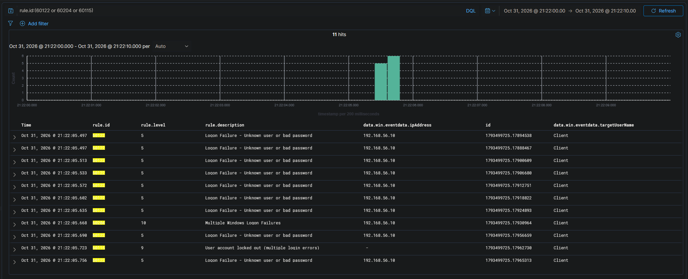
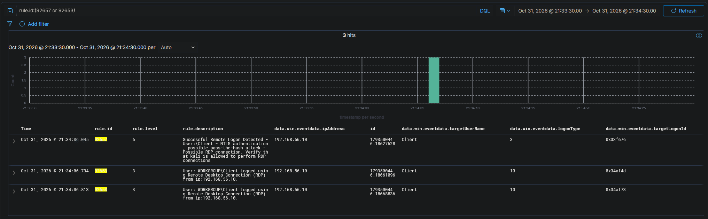
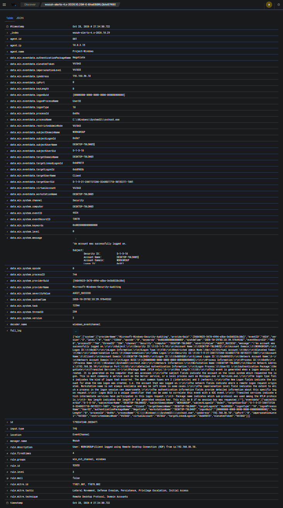
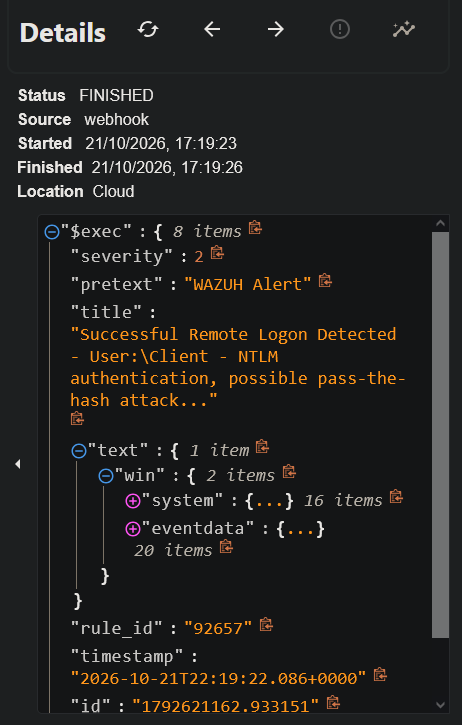
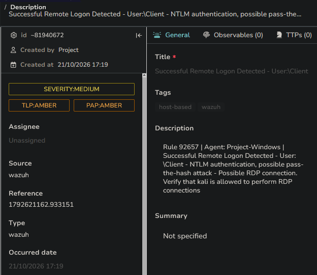

# Scenario 04 — [High] RDP Brute Force → Lockout → Interactive Session

Runs the full arc from the first failed logon to a confirmed **interactive RDP
session** on a local **administrator** account, written as an analyst would hand
it off — in ticket form. The successful-logon alerts (rules 92657 + 92653) are the
escalation trigger: the point at which a valid-credential logon turns attempted
access into a confirmed foothold — the foothold the credential-dumping chain in
[Scenario 05](05-credential-dumping.md) runs inside.

| | |
|---|---|
| **MITRE ATT&CK** | T1110.001 (Brute Force: Password Guessing) → T1021.001 (Remote Services: RDP) with T1078.003 (Valid Accounts: Local Accounts). The built-in success rules carry tags that are inexact here: 92657 tags T1550.002 (Pass the Hash) and T1078.002 (Domain Accounts), and 92653 also tags T1078.002 — §2 explains why neither is accurate for a password-guessing attack on a local account. |
| **Attacker** | Kali — 192.168.56.10 (workstation `kali`) |
| **Target** | Windows 10 — DESKTOP-T0LOHB5 (192.168.56.30) |
| **Target account** | `Client` — a **local administrator** account |
| **Detection source** | Wazuh agent → Windows Security event channel |
| **Rules fired** | 60122 (logon failure, 4625 type 3) · 60204 (brute-force correlation, 8 / 240 s) · 60115 (account lockout, 4740) · 92657 (successful NLA pre-auth, 4624 type 3) · 92653 (interactive RDP session, 4624 type 10) |
| **Reaches** | Detection → SOAR → **two** TheHive alerts (lockout `60115` + successful logon `92657`) |
| **Status** | ✅ Validated — single live pass, all five rules (incl. 60204), `2026-11-01 02:22–02:34 UTC` |

---

## 1. Attack

Remote Desktop (RDP) is one of the most abused Windows services — Sophos' **2025**
Active Adversary Report found it involved in **84%** of incident-response cases
(predominantly internal lateral movement), and internet-facing RDP remains a top
initial-access and brute-force target. The attack targets `Client`, an existing
**local administrator** account on the host — a higher-value target than a
purpose-made test account, since compromising an admin grants broad control.

Hydra's RDP module proved unreliable (experimental, NLA handshake issues) and
`ncrack` gave no clear output; an `xfreerdp3` loop with `+auth-only` was the
dependable way to generate real authentication attempts. `+auth-only` performs the
**NLA credential check only** — a network (Type 3) logon — and never opens a
desktop, so every wrong password is a clean, fast 4625:

```bash
for pass in $(cat ~/winpass.txt); do
  xfreerdp3 /u:Client /p:"$pass" /v:192.168.56.30 /cert:ignore +auth-only
done
```

Each wrong password returned `ERRCONNECT_LOGON_FAILURE [0x00020014]`. Once the
failures crossed the account's lockout threshold, **every** further attempt
returned `ERRCONNECT_ACCOUNT_LOCKED_OUT [0x00020018]`. So the loop never produced a
successful logon: **the account locked first** — the lockout control working as
designed, and the realistic consequence of a sustained single-account brute force
(which is why real attackers spray one password across many accounts to avoid it —
[T1110.003](https://attack.mitre.org/techniques/T1110/003/)).

The online guessing gained no access. The foothold was a **separate interactive RDP
session with a valid credential** — in a real intrusion obtained out-of-band
(password spray, credential reuse, or phishing); in this lab the account's own
password stands in, to exercise the successful-logon detection path. The host's
policy is `net accounts` **10 / 10 / 10** (threshold 10, lockout duration 10 min,
reset window 10 min; captured in [`config/lockout-policy.txt`](../../config/lockout-policy.txt)), so in the wild the attacker waits out the 10-minute lockout.
This run did exactly that: the brute force and lockout happened at `02:22:04` UTC,
the lockout **auto-expired after ~10 minutes** (no admin unlock needed), and the
foothold logon followed at `02:34:04` UTC. The two phases are deliberately separate
— the online guessing never got in; the access used a valid credential.

The access was a **real RDP session** (not `+auth-only`) — the attacker logging in
interactively with the valid credential (here the account's own password):

```bash
# Kali: a genuine interactive RDP session (no +auth-only) → Type-10 logon
xfreerdp3 /u:Client /p:"<valid-password>" /v:192.168.56.30 /cert:ignore
```

That genuine desktop session is what makes the foothold usable for Scenario 05's
hands-on credential dump.

> _Evidence: `evidence/scenario-04-rdp/attack-output.txt` — the brute-force console
> from this run (no password values echoed; the valid credential is redacted). Its
> clock (`22:22:04` Kali local = **`02:22 UTC`**) lines up with the manager events
> below: nine `LOGON_FAILURE` results, then `ACCOUNT_LOCKED_OUT` once the lockout
> threshold is crossed._

---

## 2. Detection

The attempts generated Windows Security events on the `Client` account, collected
by the Wazuh agent and matched on the manager. The arc splits into two filtered
views — the brute force (failure burst → correlation → lockout), then the
valid-credential logon ~12 minutes later — every row a single source
(`192.168.56.10`, workstation `kali`) against a single account (`Client`):


*Phase 1 — brute force (`@timestamp`): nine `60122` failures from `192.168.56.10`
→ `60204` "Multiple Windows Logon Failures" (8 in 240 s) → `60115` account lockout,
all on `Client`. Eleven hits, one source, one account.*


*Phase 2 — the valid-credential logon ~12 minutes later (after the lockout
expired): the Type-3 NLA pre-auth (`92657`, `targetLogonId 0x33f676`) and the
Type-10 linked token pair (`92653`, `0x34af4d` ↔ `0x34af73`), all from
`192.168.56.10`. (The `@timestamp` column is the Wazuh manager-receipt time, ~1.3 s
after each event's `systemTime`.)*

Five rules carry the story. The first three are the brute force; the last two are
the single successful RDP login, which — with NLA — records **two** 4624s:

- **Rule 60122** (level 5) — "Logon Failure - Unknown user or bad password," from
  **Event ID 4625** (`logonType 3`, `NtLmSsp` / NTLM, `status 0xC000006D` — bad
  password), source `192.168.56.10`. One per failed attempt.
  _(event `1793499725.17888467`)_
- **Rule 60204** (level 10) — "Multiple Windows Logon Failures," the built-in
  **brute-force correlation** (8 failures from one source IP within 240 s), fired at
  the 8th failure. _(event `1793499725.17930964`)_
- **Rule 60115** (level 9) — "User account locked out (multiple login errors),"
  from **Event ID 4740**; the lockout names the caller: `Caller Computer Name:
  kali`. _(event `1793499725.17962730`)_
- **Rule 92657** (level 6) — "Successful Remote Logon Detected … possible
  pass-the-hash attack," from **Event ID 4624**, `logonType 3`, `NTLM`. This is the
  **NLA network pre-authentication** of the successful login.
  _(event `1793500446.18627628`)_
- **Rule 92653** (level 3) — "User: WORKGROUP\Client logged using Remote Desktop
  Connection (RDP) from ip:192.168.56.10," from **Event ID 4624**, `logonType 10`
  (RemoteInteractive), `Negotiate`. This is the **genuine interactive desktop
  session** — the real foothold. _(event `1793500446.18661096`)_ (The rule's
  `WORKGROUP\Client` string mixes the **subject's** domain — `subjectDomainName`,
  the workgroup of the requesting computer account — with the **target** user; the
  account's actual scope is the local machine, `DESKTOP-T0LOHB5\Client`.)

**Why two success events for one login.** An RDP logon with NLA authenticates over
the network first (a Type 3 logon → `92657`) and then creates the interactive
session (a Type 10 logon → `92653`), ~0.7 s apart by event `systemTime`. The failed
attempts only ever reach the Type 3 stage, which is why every 4625 above is
`logonType 3`. The pair together is the signature of a **completed interactive RDP
login**, not merely a credential check.


*The genuine interactive session expanded — the same event as
`alert-92653-type10-session.json` (`1793500446.18661096`): `logonType 10`,
`Negotiate`, `targetLogonId 0x34af4d` linked to `0x34af73`. (A local-admin RDP
logon under UAC records a **linked pair** of Type-10 logons — a full **elevated**
token and a filtered standard token, their logon IDs cross-referenced ([Microsoft:
UAC creates two tokens](https://learn.microsoft.com/windows/security/identity-protection/user-account-control/how-user-account-control-works);
the `Linked Logon ID` pairs them, per [Microsoft's 4624 reference](https://learn.microsoft.com/windows/security/threat-protection/auditing/event-4624)) — so 92653
fires twice. This is the **elevated-token** session `0x34af4d`, the one the
Scenario 05 dump runs under.)*

**ATT&CK mapping note — the pass-the-hash tag is a false lead here.** Built-in rule
92657 is titled "possible pass-the-hash" and tags **T1550.002**, because it sees a
successful *NTLM* remote logon. But pass-the-hash means authenticating with a
stolen **hash** — and this logon used the actual **password** (the online guessing
itself never got in; the credential was obtained out-of-band — §1), so it is
**not** PtH. The NTLM package appears simply because the `Client` account is local
on a WORKGROUP host (no Kerberos/AD), so NTLM is the default. The accurate
techniques are **T1021.001 (RDP)** + **T1078.003 (Local Accounts)**; 92657 and 92653
both also tag **T1078.002 (Domain Accounts)**, which is likewise wrong for a local account.
Built-in mappings are a useful starting point, not always exact for the environment
they fire in — and knowing *why* a tag is wrong is the analyst skill the mismatch
exercises.

**Configuration note:** these detections did not work until a `<localfile>` block
for the **Security** event channel was added to the Windows agent's `ossec.conf`.
By default the agent collected Sysmon but not the Security log — two different
sensors. See [challenges-and-resolutions.md](../challenges-and-resolutions.md), item 5.

> _Evidence: `alert-60122-failure.json`, `alert-60204-correlation.json`,
> `alert-60115-lockout.json`, `alert-92657-type3-nla.json`,
> `alert-92653-type10-session.json` (+ `alert-92653-type10-linked.json`). The
> brute-force burst, the 60204 correlation, and the 4740 lockout all carry
> `systemTime 02:22:04Z`. Match artifacts by event ID; on cross-host clocks see the
> [README](../../README.md#honesty--scope-notes) convention._

---

## 3. SOAR → alert creation

The manager's Shuffle integration forwards the two **headline** RDP alerts — the
lockout (`60115`) and the successful NLA logon (`92657`) — by **rule ID**. The
per-attempt `60122` and the brute-force correlation `60204` are deliberately *not*
forwarded, so failed-logon noise never reaches the SOAR layer; and the Type-10
session rule `92653` is rich **supporting evidence** (it confirms a true interactive
session) but is also not forwarded — one headline alert per decision point, not one
per rule. Each forwarded alert produces its
own Shuffle run and its own TheHive alert:


*Shuffle run for the successful logon: `FINISHED`, `rule_id 92657`,
`id 1793500446.18627628` — the webhook received the Wazuh alert and posted to TheHive.
(The `$exec.severity` shown is Wazuh's integration value, 1–3 from the rule level, not
the TheHive severity — the Severity node sets that to **High** downstream.)*


*TheHive alert: `SEVERITY:HIGH`, tagged `92657` / wazuh, description `Rule 92657 |
Agent: Project-Windows | Successful Remote Logon Detected - User: \Client …`.
`Reference 1793500446.18627628` ties the alert to the exact Wazuh event.*

The lockout raised a **parallel alert** ~12 minutes earlier (`shuffle-rdp-lockout.png`
+ `thehive-lockout.png`, `Reference 1793499725.17962730`, rule `60115`,
`SEVERITY:MEDIUM`) — a valuable mid-attack signal in its own right, not just a
precursor to the logon.

> _Evidence: `shuffle-rdp-compromise.png`, `shuffle-rdp-lockout.png`,
> `thehive-compromise.png`, `thehive-lockout.png`. No VirusTotal enrichment applies
> here — the source is a private RFC 1918 IP VT can't resolve; the relevant
> enrichment is host/identity context (see the Ticket below)._

---

## 4. Ticket

> The format a Tier 1 analyst hands off: summary → observations → enrichment →
> verdict → recommended action → escalation.

**Alert summary**
Successful RDP logon (rules 92657 + 92653) to the local administrator account
`Client` on DESKTOP-T0LOHB5, preceded by a burst of failed logons and an account
lockout — all from a single source. Timeline (UTC, event `systemTime`): failed
logons + 60204 correlation + account lockout `02:22:04`, then the successful
interactive session `02:34:04` (after the ~10-minute lockout expired).

**Observations**
- **Source** — `192.168.56.10` (workstation name `kali`), consistent across every
  4625, the 4740 lockout, and both final 4624s. A single source driving all stages
  is the signature of a targeted brute force, not scattered user error.
- **Target** — `Client`, a **local administrator** account. High impact if
  compromised.
- **Volume & timing** — a tight burst of failures inside one second (far faster
  than human typing) → automated tooling.
- **Lockout** — rule 60115 confirms the failures crossed the lockout threshold,
  i.e. the activity was sustained, not incidental.
- **The pivot** — rules 92657 (Type 3 NLA) **and** 92653 (Type 10 interactive)
  show a *successful* login from the same attacking IP, and the Type-10 event means
  a real desktop session was established — not just a credential check. That is the
  foothold.

**Enrichment**
VirusTotal is not meaningful here — the source is an internal/private IP (RFC 1918)
that VT cannot resolve. The relevant enrichment is host/identity context: `Client`
is a local admin, the source is the known attacker host, and the logon used NTLM
(local account, no Kerberos). (Contrast Scenario 02, where the IOC is a real
external IP and VT enrichment applies.)

**Verdict** — **True Positive — confirmed interactive compromise.** Not a benign
look-alike: the single source, automated volume, lockout, and the subsequent
Type-10 RDP session from the attacking IP all align. Confidence: **High.**

**Recommended action**
- Disable / force-reset the `Client` account; its credentials are compromised.
- Isolate or investigate DESKTOP-T0LOHB5 for post-exploitation activity — this host
  is the foothold for the credential-dumping chain in
  [Scenario 05](05-credential-dumping.md), where the LSASS dump runs **inside this
  same Type-10 session** as `Client`.
- Block the source IP — safe here, because a completed RDP logon requires a real
  TCP handshake, so the source IP is genuine and not spoofable (see the tiered
  response model in [architecture.md](../architecture.md) §7).

**Escalate?** — **Yes.** A successful interactive logon to a local admin account
from a brute-force source is a confirmed compromise. Escalate to Tier 2 / incident
response with the full timeline attached.

---

## 5. Triage reasoning — malicious vs. benign

A burst of failed Windows logons (4625) is not automatically malicious. The same
pattern can come from a **benign true positive** — e.g. a stale cached credential
(a mapped drive or scheduled task holding an old password) retrying from a known
internal host. What separates this case from that benign look-alike:

| Signal | This compromise | Benign (stale credential) |
|---|---|---|
| Source | Unexpected host (`kali`) | Known internal host |
| Passwords | Many different guesses | One specific old password |
| Rate | Automated burst | Machine-steady retries |
| Outcome | **Interactive Type-10 session from the attacking IP** | Never a success from a suspicious source |

The decisive factor is the final successful 4624s from the attacking IP — and
especially the **Type-10** one, which means a real session, not a background
credential retry. See [triage-methodology.md](../triage-methodology.md) for the
false-positive vs. benign-true-positive distinction in full.

---

## 6. Lessons Learned

- **The successful logon is the alert that matters most — and "successful" has two
  halves.** Failed attempts are noise until one succeeds. Here the success is a
  *pair*: the Type-3 NLA pre-auth (92657, the headline/forwarded alert) and the
  Type-10 interactive session (92653, the proof of a real foothold). Tying them
  back to the preceding failures and lockout is the analytic core.
- **Lockout interrupts brute force — and that's realistic.** The account locked
  during the run, so the online guessing never gained access; the foothold came as
  a separate valid-credential session after the lockout cleared. A real intrusion
  against a lockout-protected system behaves the same way; the lockout alert (60115)
  is itself a valuable mid-attack signal.
- **Read the technique tags critically.** 92657's "possible pass-the-hash"
  (T1550.002) is a *false lead* here — this was an interactive logon with a valid
  password, not a replayed hash, and the account is local (T1078.003), not domain
  (T1078.002). A good
  analyst knows why a built-in mapping is wrong for the environment it fired in.
- **Two alerts, one intrusion.** Forwarding by rule ID raises an alert for the
  lockout (60115) and another for the successful logon (92657), while the
  per-attempt failures (60122), the brute-force correlation (60204), and the
  supporting Type-10 event (92653) stay out of the queue — the analyst sees the two
  decision points, not the noise.
- **Sysmon ≠ Security log.** Deep process telemetry (Sysmon) does not include
  authentication events. Collecting the Windows **Security** channel is required to
  see RDP brute force.
